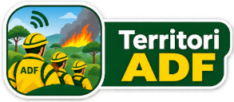
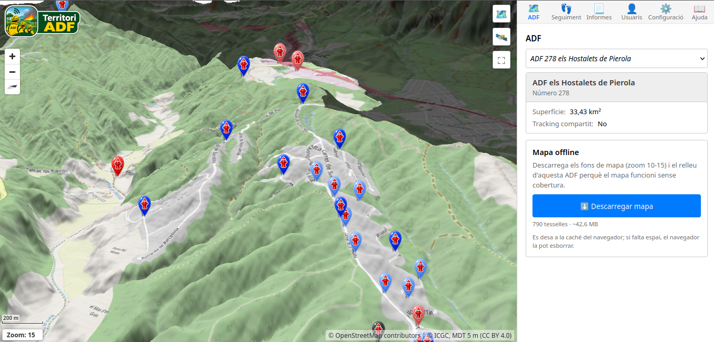
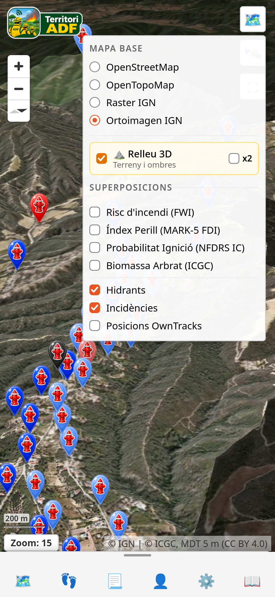
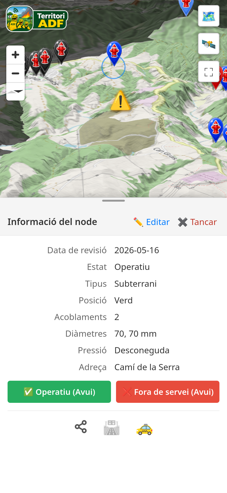

<h1 align="center">
  
</h1>

  
  
  
  

<em>Hidrants, incidències i seguiment d'unitats per a les ADF (Agrupacions de Defensa Forestal)</em>

TerritoriADF reuneix en una sola aplicació el que una ADF necessita per tenir cura del seu territori: la xarxa d'hidrants, les incidències que s'hi detecten i la posició de les unitats sobre el terreny. Funciona en un únic domini, amb una ADF o amb diverses, i cada ADF treballa amb les seves dades.

  

## Contingut

- [Què hi pots fer](#què-hi-pots-fer)
- [Stack tecnològic](#stack-tecnològic)
- [OpenStreetMap](#openstreetmap)
- [Com començar](#com-començar)

## Què hi pots fer

- **Mapa i hidrants** — Consulta la xarxa d'hidrants, crea'n de nous o edita'ls, i comparteix un enllaç a qualsevol punt. Amb límits territorials, capes base, relleu 3D i cerca ràpida.
- **Incidències** — Registra incidències als hidrants i decideix qui les pot veure: tothom, només les ADF o només la teva.
- **Seguiment d'unitats** — Segueix en temps real la posició de les unitats al mapa. Cada ADF decideix si comparteix el seu seguiment amb les altres.
- **Avisos per Telegram** — Cada ADF pot connectar el seu bot i rebre avisos al grup quan hi ha una incidència o quan es crea o s'edita un hidrant.
- **Rutes i exportació** — Calcula com arribar a un hidrant i exporta els canvis a OpenStreetMap, o prepara'ls per importar-los amb JOSM.
- **Rols i permisos** — Admin, coordinador, voluntari i consulta pública, cadascú amb el que li toca.
- **També al mòbil** — Instal·lable com una app i amb les dades de l'ADF disponibles sense connexió.

 

  
  &nbsp;&nbsp;&nbsp;
  

Al mòbil: el mapa amb relleu 3D i la fitxa d'un hidrant amb les dades d'OSM i les accions de camp.

## Stack tecnològic

- **Frontend**: React 19, TypeScript i Vite, amb MapLibre GL com a motor de mapa i Leaflet com a alternativa.
- **Backend**: Fastify 5, TypeScript, Drizzle ORM i SQLite.
- **Seguiment en temps real**: Eclipse Mosquitto (MQTT) amb OwnTracks.
- **Infraestructura**: Docker Compose, Nginx i GraphHopper.

Estructura del codi, motors de mapa i tests: [docs/ARCHITECTURE.md](docs/ARCHITECTURE.md).

## OpenStreetMap

Els hidrants es poden mantenir sincronitzats amb OpenStreetMap en les dues direccions: importar els canvis que fa la comunitat i publicar els que facis aquí. Abans de publicar, les dades es validen i els conflictes es resolen des del mateix panell. Els administradors hi tenen accés; la resta d'usuaris no hi ha de pensar.

Com funciona amb detall: [docs/OSM_SYNC.md](docs/OSM_SYNC.md).

## Com començar

- **Desenvolupament local**: [docs/DEV.md](docs/DEV.md) — variables d'entorn, base de dades, MQTT i proves.
- **Producció**: el projecte s'orquestra amb Docker Compose. La guia de desplegament és interna i no es versiona en aquest repositori; les comandes principals (`docker:deploy`, `docker:logs`) són a [docs/DEV.md](docs/DEV.md).
- **Tests**: [docs/TESTING.md](docs/TESTING.md).
- **App instal·lable i mode sense connexió**: [docs/PWA.md](docs/PWA.md).

---

_Projecte creat per Toni, ADF 278 Els Hostalets de Pierola._
